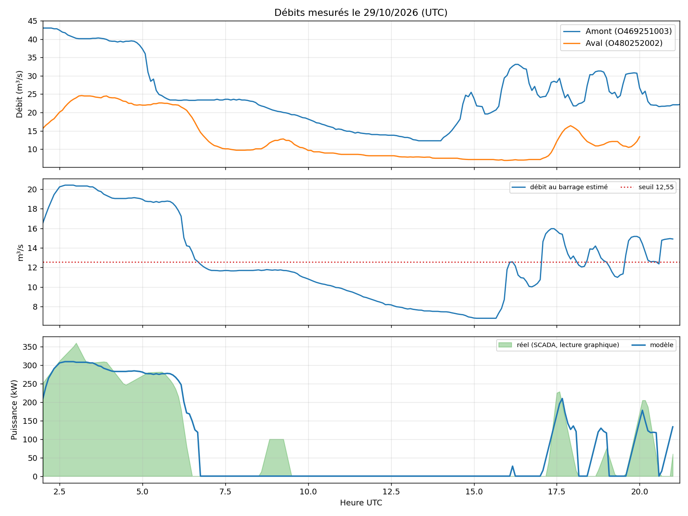

# Analyse du 29/10/2026 — modèle v1

> Version du modèle analysée : **v1** (version initiale). Archive d'analyse ;
> la version actuelle du modèle est décrite dans [`modele-turbine.md`](modele-turbine.md).
> Tous les horaires sont en **UTC** sauf mention contraire.

## Version v1 du modèle

| Paramètre | Valeur v1 |
|---|---|
| `maxTurbineFlow` / `reserveFlow` | 23,5 / 5,5 m³/s |
| `startRatio` / `stopRatio` | 0,30 / 0,30 (→ 12,55 m³/s) |
| `rampKwPerMin` | 6 kW/min |
| `efficiencyCurve` | [0,3 ; 0,5], [0,41 ; 0,65], [1 ; 0,66] |
| `tailRating` / `tailRefLevel` | a = 0,0083, b = 1,2035 / 0,05 m |
| `lag` | refMin 65, refFlow 30, exposant 0,5, maxMin 150 |
| `defaultGain` / `defaultOffset` | 0,44 / +1,4 |
| `stopHoldMin` / `calibrationWeight` | 4 min / 0 |

## Méthode

- **Référence** : courbes de puissance du SCADA (captures sur 2 h et 24 h) et CSV de débit des deux stations pour la journée du **29/10/2026**.
- Les courbes SCADA sont lues graphiquement (**précision ≈ ±10 min et ±20 kW**). L'heure SCADA est supposée égale à UTC+2 (mesurée ensuite à UTC+2h08, voir l'analyse du 30/10).
- Le modèle est rejoué toutes les 5 min avec uniquement les données disponibles à l'instant considéré ; on compare la puissance au pas 0 à la puissance mesurée.

## Résultats (02h–21h UTC)

| Indicateur | Valeur |
|---|---|
| Erreur quadratique moyenne de puissance (RMSE) | 36 kW |
| Énergie simulée / mesurée | 1621 kWh / 1565 kWh (+4 %) |
| Marche/arrêt correctement prévu | 89 % des pas de 5 min |

Le panneau du haut montre les débits mesurés aux deux stations ; celui du milieu, le débit au barrage estimé par le modèle face au seuil de 12,55 m³/s ; celui du bas, la puissance mesurée (aire verte) et celle du modèle.

## Constats sur la relation amont → barrage

Le débit au barrage nécessaire pour retrouver la puissance mesurée n'est pas une droite de pente 0,6 : sur cette journée, une régression sur 33 points en marche donne $q \approx 0{,}44\,q_{ref}+1{,}6$ (écart-type 1,25 m³/s, débits amont de 23 à 43 m³/s). Le délai amont → turbine est estimé à 75–80 min à fort débit à partir des deux stations. Les paramètres de la version v1 sont issus d'une optimisation sur cette journée (RMSE, marche/arrêt et énergie).

## Écarts connus

- Le **démarrage de 08h50–09h30 UTC** (≈100 kW mesurés) n'est probablement pas vu : le débit au barrage estimé (~11,9 m³/s) est sous le seuil.
- Les pics de **17h30 et 19h50** sont décalés ou aplatis (erreur de délai, ou de lecture graphique).
- La validation repose sur **une seule journée**, avec un seul gros événement ; les débits amont au-delà de 43 m³/s n'ont pas été observés.

## Suite

Analyses suivantes : [30/10](analyse-2026-10-30.md), [31/10](analyse-2026-10-31.md), [08/11](analyse-2026-11-08.md).
