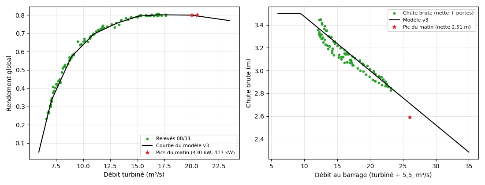
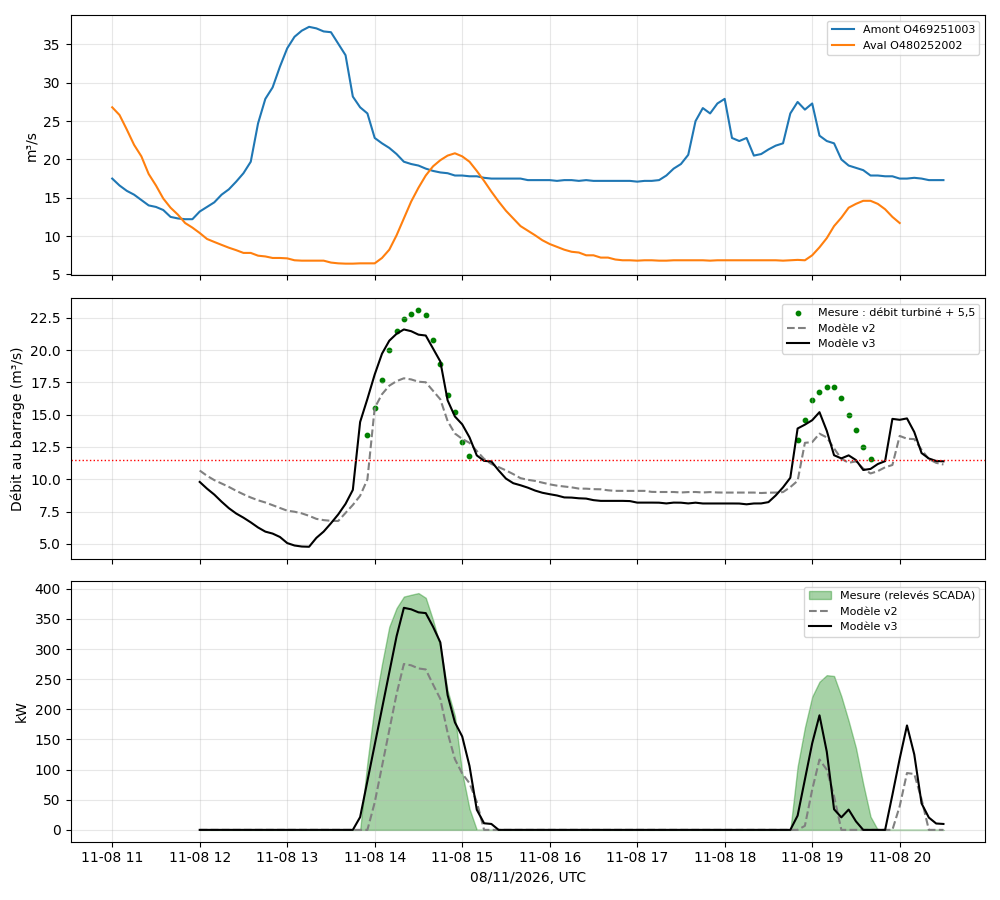

# Analyse du 08/11/2026 — recalage v2 → v3

> Versions du modèle : **v2** (avant, paramètres dans [`analyse-2026-10-31.md`](analyse-2026-10-31.md)) → **v3** (après, version décrite dans [`modele-turbine.md`](modele-turbine.md)).
> Heures en **UTC** sauf mention contraire. Depuis le passage à l'heure d'hiver, l'heure de l'IHM est l'heure de Paris (UTC+1) : il n'y a plus de décalage à corriger.

## 1. Contexte et données

- **Modification de la turbine** : les consignes de niveau de démarrage et d'arrêt ont été changées (information de l'exploitant). Le modèle doit en tenir compte.
- **Relevés de l'exploitant** (`Centrale-Sjdr-08112026.xlsx`) : un relevé par minute environ (avec quelques trous) du débit turbiné, de la puissance et de la chute nette, sur deux cycles : **14h51–16h08 Paris** (13h51–15h08 UTC) et **19h46–20h42 Paris** (18h46–19h42 UTC), plus une dernière ligne à 21h22 (0 kW). La matinée n'a pas été relevée.
- **Points de la matinée** communiqués par l'exploitant : **430 kW pour 20 m³/s turbinés** vers 9h40 Paris (08h40 UTC), et **417 kW pour 20,5 m³/s** avec 2,51 m de chute nette. Ce ne sont pas les maxima de la turbine : la puissance maximale (≈ 450–460 kW) est atteinte au débit turbiné maximal de 23,5 m³/s.
- **CSV** de débit (Q) et de niveau (H) des stations amont (O469251003) et aval (O480252002) pour le 08/11.
- **Corrections de saisie** dans le tableur : débit de 19,5 m³/s à 15h45 remplacé par une valeur interpolée (13,45) ; chutes de 303,0 et 316,0 lues 3,03 et 3,16 m. La chute brute est estimée comme chute nette + 0,0039 × débit turbiné (pertes de charge, ordre de grandeur relevé le 31/10).

## 2. Constats

### 2.1 Seuils de démarrage et d'arrêt

| Évènement | Heure Paris | Débit turbiné | Puissance |
|---|---|---|---|
| Démarrage (après-midi) | 14h51 | 6,0 m³/s | 14 kW |
| Démarrage (soir) | 19h46 | 6,3 m³/s | 33 kW |
| Dernière puissance positive (après-midi) | 16h07 | 5,9 m³/s | 12 kW |
| Dernière puissance positive (soir) | 20h41 | 5,9 m³/s | 11 kW |

La turbine démarre et s'arrête à un débit turbiné d'environ 6 m³/s, soit 25,5 % et 25 % de la capacité de 23,5 m³/s, avec les consignes de niveau actuelles. Au démarrage la puissance monte de 14 à 71 kW en une minute (le débit passe de 6,0 à 7,0 m³/s).

### 2.2 Rendement

Rendement global = P / (9,81 · Q · H brute), moyenné par classe de débit turbiné :

| Débit turbiné (m³/s) | 7,0 | 8,0 | 8,9 | 10,0 | 10,9 | 11,8 | 13,1 | 14,2 | 15,1 | 16,1 | 17,1 |
|---|---|---|---|---|---|---|---|---|---|---|---|
| Rendement | 0,33 | 0,48 | 0,57 | 0,65 | 0,70 | 0,73 | 0,76 | 0,78 | 0,80 | 0,80 | 0,80 |

Il croît jusqu'à ~15 m³/s puis plafonne vers 0,80. Les relevés du 31/10 donnent les mêmes valeurs (0,55 à 8,5 m³/s, 0,74 à 12 m³/s, 0,80 à 15,5 m³/s). Les deux pics du matin, **430 kW à 20 m³/s** et **417 kW à 20,5 m³/s avec 2,51 m de chute nette** (rendement ≈ 0,80 pour une chute brute de ~2,6 m), confirment ce plateau jusqu'à 20 m³/s.

### 2.3 Chute

La chute brute reste proche de 3,5 m jusqu'à ~9,5 m³/s au barrage, puis baisse d'environ 0,048 m par m³/s : 3,35 m à 12,5 m³/s, 3,12 m à 15,5 m³/s, 2,95 m à 20,6 m³/s, 2,87 m à 22,6 m³/s. Le pic du matin (chute brute ≈ 2,6 m pour 20,5 m³/s turbinés) prolonge cette droite jusqu'à ~28 m³/s au barrage.

### 2.4 Propagation

- **Amont → aval** : `aval(t) ≈ 0,67·amont(t − 95 min) − 4,4` (RMSE 1,8 m³/s). Le gain et le décalage sont les mêmes que les 30/10 (0,67 ; −3,9) et 31/10 (0,68 ; −5,0) : cette relation est stable sur trois journées.
- **Barrage → station aval** : le débit turbiné + 5,5 m³/s retombe sur le débit aval décalé de 25 à 30 min (écart moyen −1,3 m³/s, RMSE 1,9). Le débit au barrage vaut donc ≈ `0,67·amont − 3,4`.
- **Amont → barrage** : délai de 65 à 70 min ; le meilleur exposant du délai est de 0 à 0,25 (le jeu de données ne le contraint pas finement).

### 2.5 Matinée : débit aval et débit turbiné

De 05h à 10h30 UTC la station aval affiche ~31 m³/s (amont ~52 m³/s), alors que la turbine ne turbine que 20 à 20,5 m³/s (soit ~26 m³/s avec la réserve). La chute mesurée correspond à un débit au barrage d'environ 28 m³/s. L'écart (2 à 5 m³/s) n'est pas expliqué : surverse, autre passage ou écart de mesure de la station aval. Le modèle v3 donne 430 kW à 08h40 UTC (débit au barrage estimé 32 m³/s), ce qui correspond aux 417–430 kW mesurés.

## 3. Paramètres v2 → v3

| Paramètre | v2 | v3 | Origine |
|---|---|---|---|
| `startRatio` / `stopRatio` | 0,30 / 0,26 | **0,255 / 0,25** | §2.1 (démarrage et arrêt à ~6 m³/s turbinés) |
| `efficiencyCurve` | [0,26 ; 0,11], [0,3 ; 0,285], [0,362 ; 0,549], [0,515 ; 0,742], [0,657 ; 0,796], [1 ; 0,69] | [0,251 ; 0,05], [0,30 ; 0,331], [0,379 ; 0,572], [0,466 ; 0,696], [0,557 ; 0,756], [0,643 ; 0,795], [0,726 ; 0,802], [0,851 ; 0,80], [1 ; 0,77] | §2.2 ; 0,77 à pleine charge déduit d'une puissance maximale de ~455 kW |
| `tailRating` / `tailRefLevel` | a = 0,035, b = 1 / 0,18 m | **a = 0,0476, b = 1 / 0,45 m** | §2.3 |
| `defaultGain` / `defaultOffset` | 0,44 / +1,4 | **0,67 / −3,4** | §2.4 |
| `lag.exponent` | 0,5 | **0,25** | §2.4 |

Non modifiés : `maxTurbineFlow` (23,5 m³/s), `reserveFlow` (5,5 m³/s), `ratedPowerKw` (450 kW), `rampKwPerMin` (12), `stopHoldMin`, `calibrationWeight`.

La première version du recalage supposait que la turbine plafonnait à 20 m³/s ; l'exploitant a précisé que 430 kW à 20 m³/s est un point de la courbe et que la puissance maximale est atteinte à 23,5 m³/s turbinés. `maxTurbineFlow` reste donc à 23,5 m³/s et la courbe est exprimée en charge Q / 23,5.

## 4. Résultats rejoués avec le code réel

Le modèle est rejoué toutes les 5 min avec les seules données disponibles à l'instant considéré. La référence du 08/11 est la puissance relevée par l'exploitant, de 12h00 à 20h30 UTC (0 kW entre les deux cycles). La référence du 31/10 est le cycle du matin numérisé sur le SCADA.

| Jour (fenêtre UTC) | Indicateur | v2 | v3 |
|---|---|---|---|
| 08/11 (12h00–20h30) | RMSE de puissance | 68,0 kW | **51,1 kW** |
| 08/11 | RMSE du débit au barrage (débit turbiné + 5,5) | 3,33 m³/s | **2,13 m³/s** |
| 08/11 | Énergie simulée / mesurée | 267 / 495 kWh | 423 / 495 kWh |
| 08/11 | Marche/arrêt correct | 87,4 % | 89,3 % |
| 31/10 (07h35–09h35) | RMSE de puissance | 72,3 kW | **32,8 kW** |
| 31/10 | Énergie simulée / mesurée | 177 / 272 kWh | 253 / 272 kWh |
| 30/10 (03h–23h) | RMSE de puissance | 82,9 kW | 102,7 kW |
| 30/10 | Énergie simulée / mesurée | 2561 / 2638 kWh | 3597 / 2638 kWh |

La v3 reproduit les relevés minute par minute à 3 % près entre 14 et 23 m³/s au barrage (test unitaire). Sur le 30/10, la v3 est moins bonne : les réglages de la turbine étaient différents (voir §5).

## 5. Limites

- **Journée du 30/10** : avec la v3 le modèle surestime l'énergie de 36 %. Ce jour-là, pour un même débit à la station aval, la turbine produisait 25 à 30 % de moins que les 31/10 et 08/11 ; la v3 est calée sur les consignes actuelles et ne représente pas ce régime.
- **Matinée du 08/11** : non relevée, seuls deux points sont connus. Le débit au barrage à fort débit (§2.5) reste à expliquer.
- **Extrapolations** : le rendement au-dessus de 20,5 m³/s turbinés (0,77 à pleine charge) et la chute au-dessus de ~28 m³/s au barrage ; le débit d'arrêt en crue (51 m³/s) en dépend. Il manque un relevé à pleine capacité turbinée (23,5 m³/s).
- **Délai et gain** : calés sur deux cycles courts ; la grille de recherche donne des valeurs voisines pour plusieurs jeux (délai 65–70 min, exposant 0–0,25), donc le choix de l'exposant 0,25 n'est pas fortement contraint.
- **Démarrage** : la puissance du modèle au seuil est faible (≈ 15 kW), comme sur les relevés (14 et 33 kW), mais la montée suivante est plus rapide en réalité (≈ 20 kW/min au démarrage) que la rampe de 12 kW/min.
- **Fin de soirée** : le modèle prévoit un démarrage vers 19h55 UTC (débit estimé ~14,6 m³/s) qui n'a pas eu lieu.

## 6. Suites

1. Relevé à pleine capacité turbinée (23,5 m³/s) : puissance, chute nette, débit turbiné.
2. Relevés de la matinée (ou du prochain épisode de fort débit) pour comprendre l'écart entre la station aval et le débit turbiné.
3. Rejouer le modèle sur d'autres journées avec les consignes de niveau actuelles.
