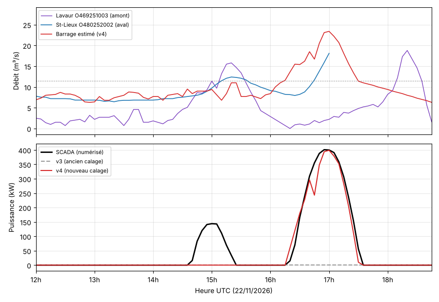

# Analyse du 22/11/2026 — recalage v3 → v4

> Versions du modèle : **v3** (avant, paramètres dans [`analyse-2026-11-08.md`](analyse-2026-11-08.md)) → **v4** (après, version décrite dans [`modele-turbine.md`](modele-turbine.md)).
> Heures en **UTC** sauf mention contraire. L'heure de l'IHM SCADA est l'heure de Paris (UTC+1) : 15h40 Paris = 14h40 UTC.

## 1. Contexte et données

- **Changement à la station de référence** : les débits de Lavaur (O469251003) ne semblent plus surestimés (information de l'exploitant). Le gain de 0,67 de la v3 compensait justement cette surestimation.
- **Observations de l'exploitant (heure de Paris)** :
  - cycle 1 : démarrage 15h40, montée progressive, plateau vers 140 kW, descente progressive, arrêt 16h22 (14h40 → 15h22 UTC) ;
  - cycle 2 : démarrage 17h20, montée jusqu'à 400 kW, descente, arrêt 18h34 (16h20 → 17h34 UTC).
- **Courbes SCADA** : deux photos de la courbe de puissance (15h16–16h46 et 17h16–18h46), numérisées en pixels (échelle 2,2 px/kW, 19,7 px/min). Incertitude de lecture : ± 10 kW et ± 2 min. Plateau lu : ~145 kW (cycle 1), 400 kW de 17h55 à 18h03 Paris (cycle 2).
- **CSV du 22/11** : Lavaur (O469251003, Q jusqu'à 18h45 et H), Saint-Lieux-lès-Lavaur (O480252002, Q et H, **jusqu'à 17h00 seulement**) et Vielmur (O460251001, H). Le niveau de Vielmur ne varie que de 0,74 à 0,81 m sur la journée : inexploitable comme référence de débit. Le Dadou (O477402001) n'a pas été fourni.

## 2. Constats

### 2.1 L'ancien calage ne prévoit plus aucun démarrage

Avec `0,67·q_ref − 3,4`, le pic de Lavaur (15,8 m³/s à 15h20) donne 7,2 m³/s au barrage, sous le seuil de démarrage (11,49 m³/s) : la v3 ne prévoit **aucune production** de la journée (énergie simulée 0 kWh pour 392 kWh relevés). Sur toute la journée, elle sous-estime le débit de la station aval de 13 m³/s en moyenne.

### 2.2 Qualité des mesures de Lavaur

Le débit de Lavaur est bas (1 à 3 m³/s hors éclusées) et **bruité** : sauts de 0,7 à 4,6 m³/s d'une mesure à l'autre à niveau quasi constant (le niveau bouge de ± 4 cm), et ~26 % de mesures manquantes sur la journée. Le débit de base à l'aval est de ~7 m³/s : environ 5 m³/s d'apports non mesurés (Dadou, ruisseaux) s'ajoutent à Lavaur.

### 2.3 Délai de propagation

- La corrélation entre le débit de Lavaur et celui de l'aval est maximale pour un décalage de **115 min** (r = 0,67). Moins ~15–35 min entre le barrage et la station aval, le délai Lavaur → barrage est de 80 à 100 min.
- Le pic de Lavaur (15h20) correspond au plateau à 400 kW de la turbine (16h55–17h03) : **≈ 95–100 min**.
- Le meilleur délai du modèle est un délai **constant de 100 min**. Les lois dépendant du débit testées (65 à 95 min à fort débit, exposant 0,25) démarrent 30 à 45 min trop tard sur cette éclusée : à 4–8 m³/s à Lavaur (début de la montée), elles donnent 120 min et plus.

### 2.4 Conversion amont → barrage

- Régression sur la journée : `aval ≈ 0,81·amont(t − 115 min) + 9,2` (RMSE 4,8 m³/s, r = 0,67). Le gain est sous-estimé par le bruit de Lavaur (dilution de la régression) et le décalage reflète les apports non mesurés.
- Calage sur le cycle du soir (grille gain 0,8–1,4 × décalage 2–8 × délai 65–120 min, modèle réel rejoué toutes les 5 min) : le délai de 100 min est le meilleur, et gain et décalage forment une **crête** (gain 1,0–1,2 avec décalage 6,5–5,5 m³/s donnent des résultats proches). Valeur retenue : **gain 1,1 ; décalage 6,0 m³/s**, proche d'un gain de 1 (conservation du débit) avec ~6 m³/s d'apports non mesurés.

### 2.5 Cycle de l'après-midi non expliqué par la station de référence

La turbine démarre à 14h40 UTC et atteint ~145 kW vers 15h00 (débit au barrage ~14 m³/s d'après la courbe de puissance), alors que Lavaur, 100 min plus tôt (13h00–13h40), lit 1 à 4,6 m³/s. La station aval confirme une montée du débit de 6,4 m³/s (13h20) à 12,4 m³/s (15h20). L'éclusée de Lavaur (14h30–15h50) arrive au barrage entre 16h10 et 17h30 : c'est le cycle du soir. Le cycle 1 vient donc d'apports **en aval de Lavaur** (le Dadou est le candidat) ou d'une montée que Lavaur n'a pas vue ; le modèle ne peut pas le prévoir avec cette seule station de référence.

### 2.6 Plateau à 400 kW

La puissance est plate à 400 kW pendant ~8 min alors que le modèle monte à 430 kW pour 25,5 m³/s au barrage (nominal 450 kW). La turbine semble limitée à 400 kW ce jour-là (consigne de puissance ou de débit ?) : à confirmer.

## 3. Paramètres v3 → v4

| Paramètre | v3 | v4 | Origine |
|---|---|---|---|
| `defaultGain` | 0,67 | **1,1** | §2.4 |
| `defaultOffset` | −3,4 m³/s | **6,0 m³/s** | §2.4 |
| `lag.refMin` | 65 min | **100 min** | §2.3 |
| `lag.exponent` | 0,25 | **0** (délai constant) | §2.3 |

Non modifiés : seuils de démarrage et d'arrêt, rendement, chute, rampe, `calibrationWeight` (0), `lag.refFlow` (30) et `lag.maxMin` (150). La borne haute du gain du calage glissant passe de 0,9 à 1,5 (`GAIN_BOUNDS`), sans effet tant que `calibrationWeight` vaut 0.

*Haut : débits de Lavaur (violet), de la station aval (bleu) et débit au barrage estimé par la v4 (rouge) ; pointillé : seuil de démarrage (11,49 m³/s). Bas : puissance SCADA numérisée (noir), v3 (gris, nulle) et v4 (rouge).*

## 4. Résultats rejoués avec le code réel

Le modèle est rejoué toutes les 5 min avec les seules données disponibles à l'instant considéré ; on compare la puissance estimée « maintenant » à la puissance SCADA numérisée (0 kW hors des deux cycles).

| Fenêtre (UTC) | Indicateur | v3 | v4 |
|---|---|---|---|
| 13h00–18h45 (journée) | RMSE de puissance | 138,5 kW | **42,4 kW** |
| | Énergie simulée / relevée | 0 / 392 kWh | 301 / 392 kWh |
| | Marche/arrêt correct | 66 % | 87 % |
| 16h00–18h45 (cycle du soir) | RMSE de puissance | 191,1 kW | **27,0 kW** |
| | Énergie simulée / relevée | 0 / 320 kWh | 301 / 320 kWh |
| | Marche/arrêt correct | 56 % | **100 %** |
| 13h00–15h45 (cycle de l'après-midi) | RMSE de puissance | 54,5 kW | 54,5 kW |
| | Énergie simulée / relevée | 0 / 72 kWh | 0 / 72 kWh |

Sur le cycle du soir, la v4 démarre à 16h20 (observé 16h20) et ne produit plus après 17h30 (arrêt observé 17h34) ; le pic simulé est de 430 kW pour 400 kW relevés (§2.6). À +60 min, la prévision reste peu fiable (RMSE 56 kW contre 138 kW pour la v3) : c'est la prévision extrapolée, déjà identifiée comme point faible.

## 5. Limites et suites

- **Un seul cycle bien expliqué** : gain et décalage sont mal séparés (crête) et dépendent de la station de Lavaur, désormais bruitée. À reconfirmer sur d'autres journées ; l'exposant du délai est à 0 faute de pouvoir le contraindre.
- **Apports non mesurés** : le CSV du Dadou (O477402001, niveau H) du 22/11 permettrait de vérifier si le cycle de l'après-midi vient de là, et d'envisager une seconde référence.
- **Filtrage de Lavaur** : une médiane glissante sur 15 à 30 min du débit de référence réduirait le bruit de ± 2 m³/s ; non testée ici (changement de structure, pas de paramètre).
- **Prévision à vérifier** : avec la v4 et les mesures de Lavaur jusqu'à 18h45 UTC, une nouvelle éclusée (pic à 18,8 m³/s à 18h20 UTC) arrive au barrage vers 20h00 UTC. Prévision : démarrage vers 20h15 Paris, pic ~390 kW vers 21h00 Paris, arrêt vers 21h25–21h30 Paris. À comparer avec le SCADA.
- **Configuration enregistrée** : si la configuration turbine a déjà été enregistrée dans le navigateur (page de configuration), elle prime sur les valeurs par défaut : remettre gain 1,1, décalage 6,0, délai de référence 100 min et exposant 0, ou réinitialiser la configuration.

## 6. Piste : seuil de démarrage plus bas et réserve plus faible (non appliquée)

Le cycle de l'après-midi (§2.5) laisse penser que le seuil de démarrage est plus bas que les 11,49 m³/s du modèle. Estimation à partir de la station aval (décalage barrage → aval de 15 à 20 min, dont 15,5 min d'après le code) :

| Démarrage (UTC) | Débit aval au moment correspondant |
|---|---|
| 14h40 (cycle 1) | 9,0 à 9,7 m³/s |
| 16h20 (cycle 2) | 8,8 à 9,4 m³/s |

Les deux démarrages donnent un seuil d'environ **9 m³/s** (8,8 à 10), soit `startRatio` ≈ 0,15 avec une réserve de 5,5. Le débit de l'aval sous-estime un peu celui du barrage dans une montée rapide, et le démarrage dépend du niveau (+4 cm) plus que du débit : estimation à confirmer.

Avec ce seuil seul, le pic du cycle 1 reste à 67 kW (relevé : 145 kW) : le modèle donne 67 kW pour 12,4 m³/s, débit de l'aval au pic. En rejouant le cycle 1 avec le débit de l'aval, une **réserve d'environ 4 m³/s** donne 140 kW au pic et un démarrage à 14h33–14h38 (RMSE de 15 à 35 kW sur 14h20–15h10, contre 64 à 71 kW avec une réserve de 5,5). Une réserve plus faible à bas niveau est plausible (surverse presque nulle à +4 cm).

**Pourquoi ce n'est pas dans le modèle.**
- Le modèle impose un seuil de démarrage au moins égal au seuil d'arrêt (`Math.max(start, min)` dans `exploitConfigFromModel`, et la machine d'états de `turbineOutlook`). Or les observations donnent un démarrage vers 9 m³/s et un arrêt du cycle 1 vers 11,4 m³/s (débit de l'aval décalé de 15 min), c'est-à-dire un seuil d'arrêt **supérieur** au seuil de démarrage : il faudrait une machine d'états qui n'arrête qu'en débit décroissant.
- Réserve et décalage amont → barrage sont liés : avec la seule station de Lavaur, une réserve de 4 au lieu de 5,5 revient à retirer 1,5 m³/s au décalage (6,0 → 4,5) et ne change presque rien à la prévision. Elle ne se vérifie qu'avec la station aval, sur deux démarrages.
- Un premier essai de rejeu avec « démarrage 8,7 / arrêt 11,4 » n'a en fait testé que la réserve de 4 : le seuil de démarrage était relevé au seuil d'arrêt par ce `Math.max`.

À reprendre avec d'autres journées (SCADA et station aval) avant de modifier la machine d'états.
