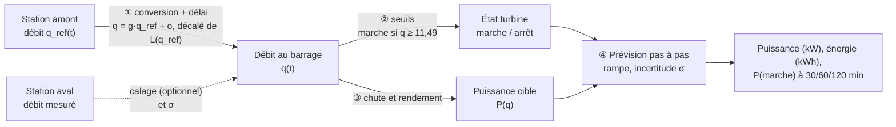
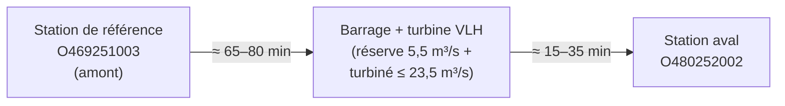
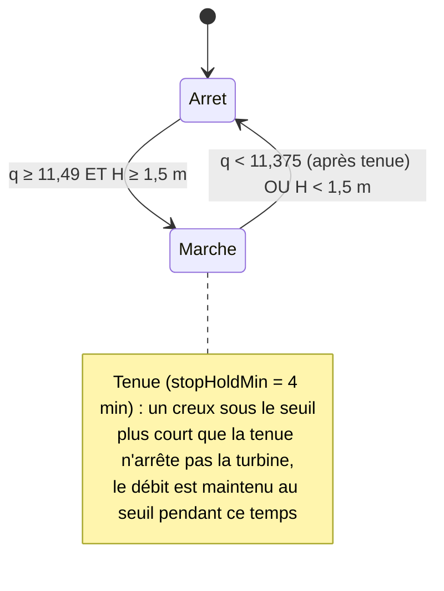

# Modèle de prévision de la turbine VLH — Saint-Jean-de-Rive (Agout)

> Documentation technique du modèle **v3** implémenté dans `apps/web/src/domain/`
> (`turbineModel.ts`, `siteFlow.ts`, `turbineForecast.ts`, `constants.ts`).
> Tous les horaires sont en **UTC** sauf mention contraire.
> Les analyses de calage, journée par journée, sont listées au §8.

---

## 1. En bref

Le modèle répond à une question : **« combien de puissance la turbine va-t-elle produire dans les deux prochaines heures ? »**

Il part d'une mesure de **débit à une station amont**, estime le **débit qui arrivera au barrage**, en déduit si la turbine **tourne ou non**, puis calcule la **puissance** (chute × débit × rendement). Une probabilité de marche accompagne chaque pas de prévision.



Lecture rapide des quatre étapes :

| # | Étape | Idée | Équation clé |
|---|---|---|---|
| ① | Amont → barrage | Le débit amont est multiplié par un gain, décalé, et arrive avec un retard qui dépend du débit | $q = g\,q_{ref}+o$ |
| ② | Débit → état | Le débit de réserve passe d'abord ; la turbine démarre à environ 25 % de sa capacité | $q_{seuil}=q_{res}+0{,}255\,Q_{max}$ |
| ③ | Débit → puissance | Puissance hydraulique, rendement variable, chute qui baisse avec le débit | $P = 9{,}81\,\eta\,Q_t\,H$ |
| ④ | Prévision | Observé tant que l'onde amont est connue, puis tendance extrapolée avec incertitude croissante | $\sigma(t)=\sqrt{\sigma_c^2+(3\,\Delta h)^2}$ |

---

## 2. Le site et ses grandeurs



- **Station de référence** (`refCode`) : donne le débit amont, avec de l'avance sur ce qui arrivera au barrage.
- **Station aval** (`downCode`) : sert à vérifier/caler la conversion et fournit l'incertitude σ. Elle est située après la turbine : elle voit le débit total restitué. Le délai barrage → station aval est de ~15 min vers 21 m³/s et monte à ~35 min vers 12 m³/s.
- **Débit de réserve** `reserveFlow` = 5,5 m³/s (passe à poissons + surverse). Il est prélevé **en premier** ; seul le reste va à la turbine.
- **Capacité turbinée** `maxTurbineFlow` = 23,5 m³/s, **hors réserve** : le débit de réserve s'*ajoute* au débit turbiné. Le débit au barrage à pleine capacité est donc 5,5 + 23,5 = 29 m³/s.
- **Puissance nominale** 450 kW, atteinte au débit turbiné maximal. Chute brute au repos : 3,5 m.

Notations utilisées ci-dessous : $q$ débit au barrage (m³/s), $Q_t$ débit turbiné, $H$ chute (m), $P$ puissance (kW).

---

## 3. Étape ① — Du débit amont au débit au barrage

### 3.1 Conversion linéaire

Le débit au barrage n'est pas celui de la station amont : les apports intermédiaires, les prélèvements et les travaux en amont changent le rapport entre les deux. Le modèle utilise une droite :

$$ q_{site} = \max\bigl(0,\; g\cdot q_{ref} + o\bigr) $$

avec `defaultGain` $g = 0{,}67$ et `defaultOffset` $o = -3{,}4$ m³/s.


La droite coupe le seuil de démarrage (11,49 m³/s) pour un débit amont d'environ **22 m³/s**.

### 3.2 Délai de propagation

L'onde met du temps à descendre de la station amont à la turbine, et **plus longtemps quand le débit est faible** :

$$ L(q_{ref}) = \min\!\Bigl(L_{max},\; L_0\cdot \max\bigl(1,\tfrac{q_{0}}{q_{ref}}\bigr)^{\alpha}\Bigr) $$

| Symbole | Paramètre | Valeur |
|---|---|---|
| $L_0$ | `lag.refMin` | 65 min |
| $q_0$ | `lag.refFlow` | 30 m³/s |
| $\alpha$ | `lag.exponent` | 0,25 |
| $L_{max}$ | `lag.maxMin` | 150 min |


Chaque mesure amont est convertie, puis **décalée de son propre délai**. Comme le délai diminue quand le débit monte, une montée « rattrape » les valeurs qui la précèdent (front raide) ; les arrivées sont alors espacées d'au moins 1 minute pour garder une série croissante en temps (`siteFlowSeries`).

### 3.3 Calage glissant sur la station aval (optionnel)

`calibrateSite` compare, sur les **72 dernières heures**, le débit amont décalé et le débit aval mesuré :

1. Couples $(x_i, y_i)$ = (débit amont décalé, débit aval) ; le décalage vers l'aval utilise `downLagRatio` = 17,73/15,35 ≈ 1,155 (rapport des distances de lit). Les séries **figées** (valeur identique > 90 min) sont écartées. Il faut au moins 24 couples.
2. Régression : gain $g_{fit}=\dfrac{\sum (x-\bar x)(y-\bar y)}{\sum (x-\bar x)^2}$ (seulement si `fitGain` est vrai et si l'écart-type de $x$ ≥ 2, borné à [0,35 ; 0,9]) ; décalage $o_{fit}=\bar y-g\bar x$.
3. Correction du biais sur les **3 dernières heures**.
4. Mélange avec les valeurs par défaut selon `calibrationWeight` $w$ :

$$ g = (1-w)\,g_0 + w\,g_{fit}, \qquad o = (1-w)\,o_0 + w\,o_{fit} $$

5. Incertitude de conversion : $\sigma_c = \max\bigl(0{,}5,\; \sqrt{\tfrac1n\sum (y_i - g x_i - o)^2}\bigr)$ (2,5 par défaut s'il n'y a pas assez de couples).

> **Réglage actuel : $w = 0$.** Le calage ne modifie pas $g$ et $o$ ; il fournit seulement l'incertitude $\sigma_c$. Les valeurs fixes se sont montrées meilleures que le calage glissant, qui absorbe mal les variations entre régimes de débit.

---

## 4. Étape ② — État de la turbine (marche / arrêt)

### 4.1 Seuils

Le débit de réserve est prélevé d'abord ; la turbine ne démarre que si son débit atteint 25,5 % de sa capacité :

$$ q_{start} = q_{res} + r_{start}\,Q_{max} = 5{,}5 + 0{,}255 \times 23{,}5 = 11{,}49\ \text{m}^3/\text{s} $$

Soit un débit turbiné d'environ 6,0 m³/s. Le seuil d'arrêt est calculé de la même façon avec `stopRatio` = 0,25 : $5{,}5 + 0{,}25 \times 23{,}5 = 11{,}375$ m³/s (hystérésis de ~0,1 m³/s : le démarrage et l'arrêt se font à un débit turbiné proche de 6 m³/s, avec les consignes de niveau actuelles).

Au seuil, le modèle donne environ **15 kW** au démarrage et **10 kW** à l'arrêt ; la puissance monte ensuite très vite avec le débit (≈ 140 kW à 14 m³/s au barrage).

### 4.2 Arrêt en crue

Quand le débit monte, la chute brute diminue (le niveau aval monte). Sous `headMin` = 1,5 m la turbine s'arrête : cela correspond à $q \approx 51$ m³/s (`maxSiteFlow`, résolu par dichotomie ; **extrapolé** au-delà de ~31 m³/s, dernier point de chute connu).

### 4.3 Machine à états



**Tenue (`rideThrough`)** : la retenue amortit les creux courts. Pendant `stopHoldMin` minutes après le début d'un creux sous 11,375, le débit est relevé au seuil d'arrêt ; au-delà, la turbine s'arrête. Valeur actuelle : 4 min.

L'état initial vient du rejeu de la série (`turbineOutlook` / `inferTurbineState`).

---

## 5. Étape ③ — Puissance

### 5.1 Équation

$$ P(q) = \min\Bigl(P_{nom},\; 9{,}81\;\eta(c)\;Q_t\;H(q)\Bigr), \qquad Q_t=\min\bigl(\max(q-q_{res},0),\,Q_{max}\bigr) $$

avec la charge $c = Q_t / Q_{max}$. $P = 0$ si $q<q_{stop}$ ou si $H<H_{min}$.

### 5.2 Rendement

Le rendement global (turbine + génératrice) croît avec la charge, culmine vers 0,80 entre 65 et 85 % de charge, puis baisse légèrement ; interpolation linéaire entre les points :

| Charge $c$ | 0,251 | 0,30 | 0,379 | 0,466 | 0,557 | 0,643 | 0,726 | 0,851 | 1,00 |
|---|---|---|---|---|---|---|---|---|---|
| $Q_t$ (m³/s) | 5,9 | 7,05 | 8,9 | 10,95 | 13,1 | 15,1 | 17,05 | 20,0 | 23,5 |
| $\eta$ | 0,05 | 0,331 | 0,572 | 0,696 | 0,756 | 0,795 | 0,802 | 0,80 | 0,77 |

(constant à 0,05 sous $c=0{,}251$ et à 0,77 au-delà de $c=1$.) Les points de 5,9 à 17,05 m³/s turbinés sont mesurés (relevés minute par minute d'un cycle d'exploitation) ; le point à 20 m³/s est confirmé par deux pics (430 kW à 20 m³/s, 417 kW à 20,5 m³/s avec 2,51 m de chute nette). Le point à pleine charge (0,77) est déduit de la puissance maximale, de l'ordre de 450 kW à 23,5 m³/s turbinés.

### 5.3 Chute brute

$$ H(q) = \min\Bigl(H_0 - \max\bigl(0,\; h_{aval}(q) - h_{ref}\bigr) - \delta,\; H_{max}\Bigr) $$

- $H_0 = (\text{poolLowCm} - \text{tailLowCm})/100 = (-30 - (-380))/100 = 3{,}5$ m : chute à débit faible. Le niveau amont est supposé constant.
- $h_{aval}(q) = a\,q^{b}$ avec $a = 0{,}0476$, $b = 1$ (remontée du niveau aval au barrage en fonction du débit au barrage, ajustée sur les chutes brutes lues au SCADA) ; $h_{ref}$ = `tailRefLevel` = 0,45 m. Il n'y a donc pas de remontée sous 9,5 m³/s, puis le niveau aval monte de 4,8 cm par m³/s.
- $\delta$ = `headCorrection` = 0 (voir §9, point ouvert).
- $H_{max} = 3{,}5$ m.

Ordre de grandeur : $H = 3{,}40$ m à 11,5 m³/s, 3,12 m à 17,5 m³/s, 2,96 m à 20,8 m³/s, 2,57 m à 29 m³/s, 2,47 m à 31 m³/s, 2,05 m à 40 m³/s (extrapolé au-delà de ~31 m³/s).


### 5.4 Courbe de puissance résultante


Deux régimes :

1. **11,49 → 29 m³/s** : la puissance monte avec le débit turbiné (de ~15 kW à 450 kW) ; elle est de 266 kW à 17,5 m³/s, 334 kW à 20 m³/s, 393 kW à 23 m³/s.
2. **> 29 m³/s** : le débit turbiné est plafonné à 23,5 m³/s, mais la chute baisse avec la montée du niveau aval, donc la puissance **diminue** (439 kW à 31 m³/s, 363 kW à 40 m³/s) jusqu'à l'arrêt en crue (~51 m³/s, extrapolé).

La **zone optimale** (`optimalShare` = 80 % du nominal, soit ≥ 360 kW) s'étend de 21,2 à 40,2 m³/s au barrage.

---

## 6. Étape ④ — La prévision

`turbineForecast` produit des pas de **5 min** sur **120 min**.

### 6.1 Débit connu, puis extrapolé

- Jusqu'à `knownUntil` = (dernière mesure amont + délai), le débit au barrage est **déjà connu** (source `observed`).
- Au-delà, la série est prolongée par **extrapolation de tendance** (`analyzeSeries` / `projectSeries`, module `trend.ts`), source `estimated`.

### 6.2 Incertitude et probabilité de marche

L'incertitude démarre à celle de la conversion et **croît de 3 m³/s par heure** au-delà du dernier débit connu :

$$ \sigma(t) = \sqrt{\sigma_c^{2} + \bigl(3\cdot\Delta h\bigr)^{2}} $$

où $\Delta h$ est le temps (en heures) passé depuis `knownUntil`. La probabilité que le débit réel soit dans la plage de marche, avec $\Phi$ la loi normale centrée réduite :

$$ p_{run} = \Phi\!\Bigl(\tfrac{q_{max}-q}{\sigma}\Bigr) - \Phi\!\Bigl(\tfrac{q_{seuil}-q}{\sigma}\Bigr) $$

avec $q_{seuil}= q_{stop}$ si la turbine tourne, $q_{start}$ sinon ; $q_{max}$ = débit de crue d'arrêt. Sorties : P(marche) à 30, 60 et 120 min.

### 6.3 Rampe de puissance

La turbine suit le niveau amont : elle ne saute pas à sa puissance cible. À chaque pas, la puissance se rapproche de la cible de **au plus** `rampKwPerMin` × 5 min = 60 kW :

$$ P_{k+1} = P_k + \mathrm{clip}\bigl(P^{\text{cible}}_{k+1}-P_k,\; -60,\; +60\bigr) $$

Au pas 0, si la turbine tourne : $P_0=\min\bigl(P^{\text{cible}},\ \text{rampKwPerMin}\times\text{durée de marche}\bigr)$, la durée de marche étant le temps écoulé depuis que $q$ est repassé au-dessus du seuil d'arrêt (`runningMin`).

L'énergie prévue est $E=\sum_k P_k \cdot 5/60$ (kWh).

### 6.4 Exemple

Prévision émise le 08/11 à 14h30 UTC, au pic du cycle de l'après-midi :


À gauche : débit au barrage prévu et bande ±σ ; à droite : puissance prévue (≈ 360 kW en marche, arrêt vers +50 min) et probabilité de marche. La bande s'élargit au fil du temps, la probabilité de marche suit.

### 6.5 Régime réduit (inactif)

`reducedPowerKw` (150 kW) et `reducedMin` (0 min) permettraient de modéliser une phase à puissance réduite après un arrêt (niveau amont redescendu à 0 cm). Avec `reducedMin = 0`, ce mécanisme est **désactivé**.

---

## 7. Tableau complet des paramètres

| Paramètre | Valeur | Rôle |
|---|---|---|
| `refCode` / `downCode` | O469251003 / O480252002 | Stations amont et aval |
| `reserveFlow` | 5,5 m³/s | Passe à poissons + surverse, prélevé en premier |
| `maxTurbineFlow` | 23,5 m³/s | Capacité turbinée (hors réserve) |
| `startRatio` / `stopRatio` | 0,255 / 0,25 | Seuils en part de la capacité (→ 11,49 / 11,375 m³/s) |
| `ratedPowerKw` | 450 kW | Puissance nominale |
| `stopHoldMin` | 4 min | Tenue d'un creux sous le seuil |
| `rampKwPerMin` | 12 kW/min | Vitesse de montée/descente |
| `efficiency` | 0,65 | Rendement constant, utilisé seulement si la courbe est vide |
| `efficiencyCurve` | [0,251 ; 0,05], [0,30 ; 0,331], [0,379 ; 0,572], [0,466 ; 0,696], [0,557 ; 0,756], [0,643 ; 0,795], [0,726 ; 0,802], [0,851 ; 0,80], [1 ; 0,77] | Rendement selon la charge |
| `headMin` / `headMax` | 1,5 / 3,5 m | Plage de chute de fonctionnement |
| `poolLowCm` / `tailLowCm` | −30 / −380 cm | Repères de niveaux → $H_0 = 3{,}5$ m |
| `tailRefLevel` | 0,45 m | Seuil de remontée du niveau aval |
| `headCorrection` | 0 m | Correction de chute (définition non confirmée) |
| `tailRating` | a = 0,0476, b = 1 | Remontée du niveau aval en fonction du débit |
| `lag` | refMin 65, refFlow 30, exposant 0,25, maxMin 150 | Délai de propagation |
| `downLagRatio` | 17,73 / 15,35 | Rapport de distances aval/turbine |
| `defaultGain` / `defaultOffset` | 0,67 / −3,4 | Conversion amont → barrage |
| `fitGain` | faux | Le calage n'ajuste pas le gain |
| `calibrationWeight` | 0 | Poids du calage glissant |
| `optimalShare` | 0,8 | Zone optimale = ≥ 80 % du nominal |

---

## 8. Analyses de calage

Une doc par journée d'analyse, avec les données, la version du modèle utilisée et les résultats :

| Journée | Version du modèle analysée | Doc |
|---|---|---|
| 29/10/2026 | v1 (initiale) | [`analyse-2026-10-29.md`](analyse-2026-10-29.md) |
| 30/10/2026 | v1 | [`analyse-2026-10-30.md`](analyse-2026-10-30.md) |
| 31/10/2026 | v1 → v2 | [`analyse-2026-10-31.md`](analyse-2026-10-31.md) |
| 08/11/2026 | v2 → **v3 (version décrite ici)** | [`analyse-2026-11-08.md`](analyse-2026-11-08.md) |

Résultats de la version v3 sur le cycle de l'après-midi et du soir du 08/11 (relevés minute par minute) : RMSE de puissance 51 kW, débit au barrage à 2,1 m³/s près ; sur le cycle du matin du 31/10 : RMSE 33 kW. Détail et limites dans la doc du 08/11.

---

## 9. Hypothèses, limites et points ouverts

**Hypothèses du modèle**
- Niveau amont supposé constant (la chute ne varie qu'avec le niveau aval).
- Rendement dépendant de la seule charge (pas de la chute ni de la température).
- Relation débit amont → barrage linéaire, constante dans le temps (le calage glissant est désactivé).
- Les seuils de démarrage et d'arrêt dépendent des consignes de niveau de la turbine ; ils sont calés sur les consignes en vigueur le 08/11 et sont à recaler si elles changent.
- Le débit au barrage vaut le débit turbiné plus 5,5 m³/s : à fort débit, une part de l'eau passe ailleurs (voir ci-dessous).

**Points à confirmer ou à décider**

1. **Débit au barrage à fort débit** : le 08/11 au matin, la station aval affichait ~31 m³/s alors que la turbine ne turbinait que 20 à 20,5 m³/s (soit 26 m³/s avec la réserve) ; la chute mesurée (2,51 m nette) correspond à un débit au barrage d'environ 28 m³/s. Le modèle donne ~430 kW pour 31 m³/s, ce qui est cohérent avec les mesures (417 à 430 kW), mais l'origine des ~2 à 5 m³/s d'écart (surverse, autre passage) n'est pas établie.
2. **Extrapolations** : rendement et chute au-dessus de 23 m³/s turbinés (~29 m³/s au barrage) ; le débit d'arrêt en crue (51 m³/s) en dépend. Il manque des relevés SCADA à pleine capacité.
3. **Gain amont → barrage** : 0,67 / −3,4, cohérent sur les journées du 30/10, 31/10 et 08/11 avec la station aval (`aval ≈ 0,67·amont(t−95 min) − 4,4`), mais le 30/10 la puissance mesurée était plus faible que celle donnée par le modèle pour le même débit (réglages de la turbine antérieurs au 08/11).
4. **`calibrationWeight`** : 0 (valeurs fixes) ou une valeur partielle (0,2–0,5) pour absorber les changements de régime, à trancher après validation sur d'autres journées.
5. **`headCorrection`** : sa définition n'est pas confirmée ; elle vaut 0 aujourd'hui.
6. **Régime réduit** (`reducedPowerKw`, `reducedMin`) : le conserver désactivé ou le supprimer ?
7. **Heure du SCADA** : l'heure de l'IHM suit l'heure de Paris depuis le passage à l'heure d'hiver (UTC+1) ; les analyses des 29 au 31/10 ont été faites avec un décalage de +2h08 sur UTC.

---

## Annexe A — Pseudo-code de `turbineForecast`

```text
calibration = calibrateSite(ref, aval, modèle, maintenant)         # §3.3
site        = siteFlowSeries(ref, calibration, modèle)               # §3.1–3.2
site        = rideThrough(site, seuil_arrêt, stopHoldMin)            # §4.3
etat        = état initial (rejeu de la série)                       # §4.3
pour minute = 0, 5, …, 120 :
    q      = débit observé si t ≤ knownUntil sinon extrapolation     # §6.1
    sigma  = hypot(calibration.sigma, 3 × heures_après_knownUntil)   # §6.2
    si arrêt et q ≥ seuil_démarrage et H(q) ≥ 1,5 : etat = marche
    si marche et (q < seuil_arrêt ou H(q) < 1,5)  : etat = arrêt
    cible  = P(q) si marche sinon 0                                  # §5
    P      = P précédent + clip(cible − P précédent, ±12×5)          # §6.3
    pRun   = Φ((q_max − q)/σ) − Φ((seuil − q)/σ)                    # §6.2
```

## Annexe B — Valeurs dérivées

| Grandeur | Valeur |
|---|---|
| Débit turbiné au démarrage / à l'arrêt | ≈ 6,0 / 5,9 m³/s |
| Débit au barrage au démarrage / arrêt | 11,49 / 11,375 m³/s |
| Puissance au démarrage / à l'arrêt | ≈ 15 kW / ≈ 10 kW |
| Puissance maximale | 450 kW (plafond nominal) vers 29 m³/s au barrage |
| Zone optimale (≥ 360 kW) | 21,2 – 40,2 m³/s |
| Débit d'arrêt en crue ($H<1{,}5$ m) | ≈ 51 m³/s (extrapolé) |
| Débit amont équivalent au seuil de démarrage | ≈ 22 m³/s |
| Rampe max par pas de 5 min | 60 kW |

## Annexe C — Fichiers de code

| Fichier | Contenu |
|---|---|
| `constants.ts` | `DEFAULT_TURBINE_MODEL` (paramètres) |
| `turbineModel.ts` | Seuils, chute, rendement, puissance, zone optimale |
| `siteFlow.ts` | Délai, calage, conversion amont → barrage, tenue |
| `turbineForecast.ts` | Prévision pas à pas, probabilités, énergie |
| `turbineOutlook.ts` | Cas d'exploitation (démarrage, arrêt, stabilité) |
| `types.ts` | Types `TurbineModel`, `SiteCalibration`, `ForecastStep` |
