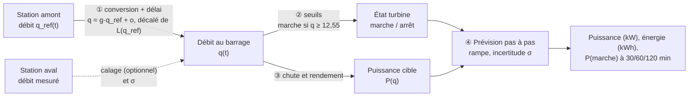
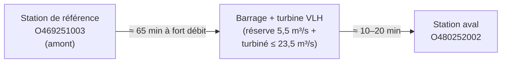
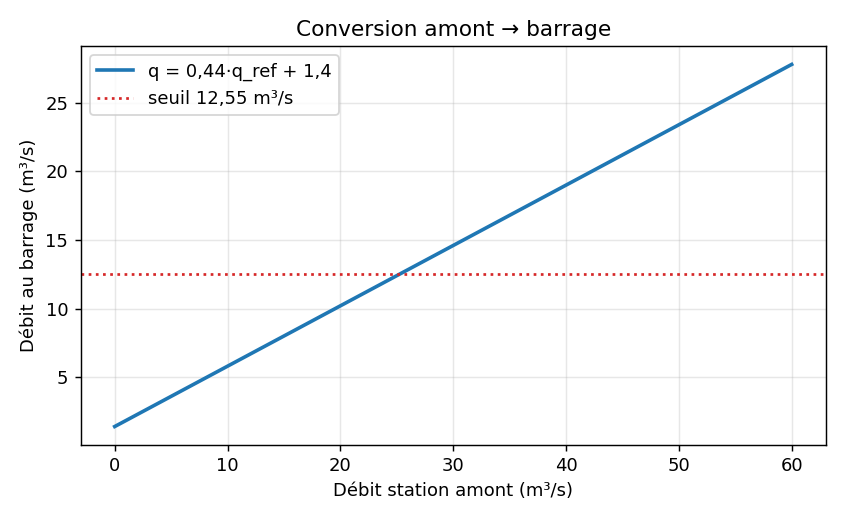
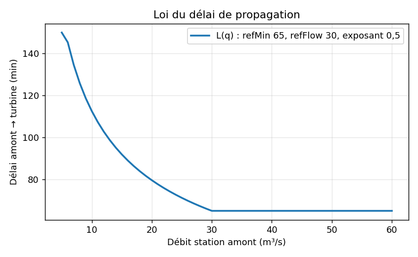
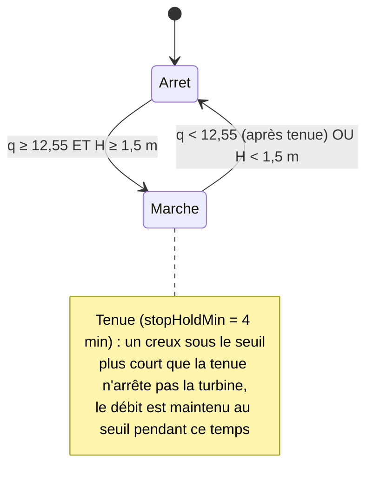
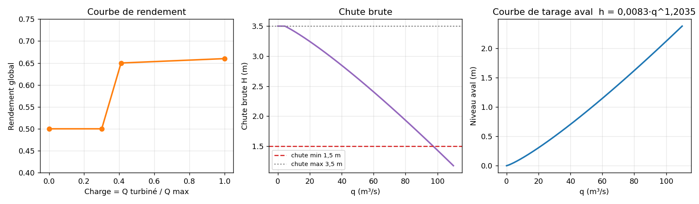
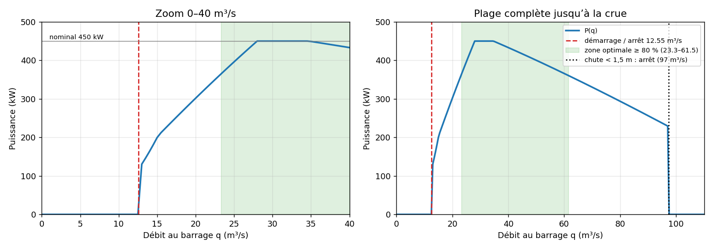
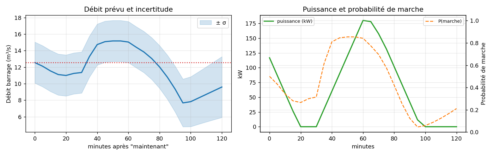
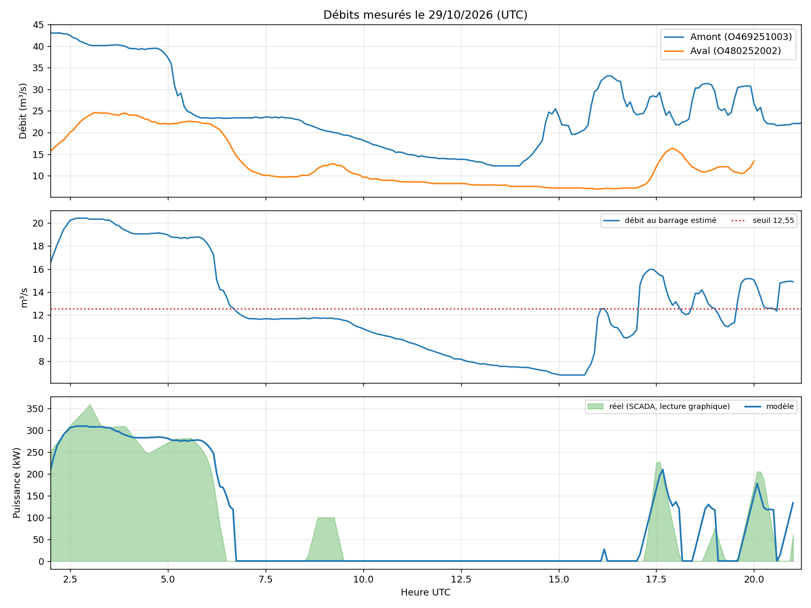

# Modèle de prévision de la turbine VLH — Saint-Jean-de-Rive (Agout)

> Documentation technique du modèle implémenté dans `apps/web/src/domain/`
> (`turbineModel.ts`, `siteFlow.ts`, `turbineForecast.ts`, `constants.ts`).
> Tous les horaires sont en **UTC** sauf mention contraire.

---

## 1. En bref

Le modèle répond à une question : **« combien de puissance la turbine va-t-elle produire dans les deux prochaines heures ? »**

Il part d'une mesure de **débit à une station amont**, estime le **débit qui arrivera au barrage**, en déduit si la turbine **tourne ou non**, puis calcule la **puissance** (chute × débit × rendement). Une probabilité de marche accompagne chaque pas de prévision.



Lecture rapide des quatre étapes :

| # | Étape | Idée | Équation clé |
|---|---|---|---|
| ① | Amont → barrage | Le débit amont est multiplié par un gain, décalé, et arrive avec un retard qui dépend du débit | $q = g\,q_{ref}+o$ |
| ② | Débit → état | Le débit de réserve passe d'abord ; la turbine démarre au-delà de 30 % de sa capacité | $q_{seuil}=q_{res}+0{,}3\,Q_{max}$ |
| ③ | Débit → puissance | Puissance hydraulique, rendement variable, chute qui baisse avec le débit | $P = 9{,}81\,\eta\,Q_t\,H$ |
| ④ | Prévision | Observé tant que l'onde amont est connue, puis tendance extrapolée avec incertitude croissante | $\sigma(t)=\sqrt{\sigma_c^2+(3\,\Delta h)^2}$ |

---

## 2. Le site et ses grandeurs



- **Station de référence** (`refCode`) : donne le débit amont, avec de l'avance sur ce qui arrivera au barrage.
- **Station aval** (`downCode`) : sert à vérifier/caler la conversion et fournit l'incertitude σ. Elle est située après la turbine : elle voit le débit total restitué.
- **Débit de réserve** `reserveFlow` = 5,5 m³/s (passe à poissons + surverse). Il est prélevé **en premier** ; seul le reste va à la turbine.
- **Capacité turbinée** `maxTurbineFlow` = 23,5 m³/s, **hors réserve** : le débit de réserve s'*ajoute* au débit turbiné. Le débit au barrage à pleine capacité est donc 5,5 + 23,5 = 29 m³/s.
- **Puissance nominale** 450 kW. Chute brute au repos : 3,5 m.

Notations utilisées ci-dessous : $q$ débit au barrage (m³/s), $Q_t$ débit turbiné, $H$ chute (m), $P$ puissance (kW).

---

## 3. Étape ① — Du débit amont au débit au barrage

### 3.1 Conversion linéaire

Le débit au barrage n'est pas celui de la station amont : les apports intermédiaires, les prélèvements et les travaux en amont changent le rapport entre les deux. Le modèle utilise une droite :

$$ q_{site} = \max\bigl(0,\; g\cdot q_{ref} + o\bigr) $$

avec `defaultGain` $g = 0{,}44$ et `defaultOffset` $o = +1{,}4$ m³/s.



La droite coupe le seuil de démarrage (12,55 m³/s) pour un débit amont d'environ **25 m³/s**.

### 3.2 Délai de propagation

L'onde met du temps à descendre de la station amont à la turbine, et **plus longtemps quand le débit est faible** :

$$ L(q_{ref}) = \min\!\Bigl(L_{max},\; L_0\cdot \max\bigl(1,\tfrac{q_{0}}{q_{ref}}\bigr)^{\alpha}\Bigr) $$

| Symbole | Paramètre | Valeur |
|---|---|---|
| $L_0$ | `lag.refMin` | 65 min |
| $q_0$ | `lag.refFlow` | 30 m³/s |
| $\alpha$ | `lag.exponent` | 0,5 |
| $L_{max}$ | `lag.maxMin` | 150 min |



Chaque mesure amont est convertie, puis **décalée de son propre délai**. Comme le délai diminue quand le débit monte, une montée « rattrape » les valeurs qui la précèdent (front raide) ; les arrivées sont alors espacées d'au moins 1 minute pour garder une série croissante en temps (`siteFlowSeries`).

### 3.3 Calage glissant sur la station aval (optionnel)

`calibrateSite` compare, sur les **72 dernières heures**, le débit amont décalé et le débit aval mesuré :

1. Couples $(x_i, y_i)$ = (débit amont décalé, débit aval) ; le décalage vers l'aval utilise `downLagRatio` = 17,73/15,35 ≈ 1,155 (rapport des distances de lit). Les séries **figées** (valeur identique > 90 min) sont écartées. Il faut au moins 24 couples.
2. Régression : gain $g_{fit}=\dfrac{\sum (x-\bar x)(y-\bar y)}{\sum (x-\bar x)^2}$ (seulement si `fitGain` est vrai et si l'écart-type de $x$ ≥ 2, borné à [0,35 ; 0,9]) ; décalage $o_{fit}=\bar y-g\bar x$.
3. Correction du biais sur les **3 dernières heures**.
4. Mélange avec les valeurs par défaut selon `calibrationWeight` $w$ :

$$ g = (1-w)\,g_0 + w\,g_{fit}, \qquad o = (1-w)\,o_0 + w\,o_{fit} $$

5. Incertitude de conversion : $\sigma_c = \max\bigl(0{,}5,\; \sqrt{\tfrac1n\sum (y_i - g x_i - o)^2}\bigr)$ (2,5 par défaut s'il n'y a pas assez de couples).

> **Réglage actuel : $w = 0$.** Le calage ne modifie pas $g$ et $o$ ; il fournit seulement l'incertitude $\sigma_c$. Les valeurs fixes se sont montrées meilleures que le calage glissant, qui absorbe mal les variations entre régimes de débit (voir §8).

---

## 4. Étape ② — État de la turbine (marche / arrêt)

### 4.1 Seuils

Le débit de réserve est prélevé d'abord ; la turbine ne démarre que si son débit atteint 30 % de sa capacité :

$$ q_{start} = q_{res} + r_{start}\,Q_{max} = 5{,}5 + 0{,}3 \times 23{,}5 = 12{,}55\ \text{m}^3/\text{s} $$

Soit un débit turbiné de $0{,}3 \times 23{,}5 = 7{,}05$ m³/s (« autour de 7 » sur le terrain). Le seuil d'arrêt est calculé de la même façon avec `stopRatio` (aujourd'hui égal à `startRatio` : pas d'hystérésis de débit).

À ce seuil, le modèle donne environ **117 kW** ($\eta=0{,}5$, $H\approx3{,}38$ m), cohérent avec les ~100 kW observés au démarrage.

### 4.2 Arrêt en crue

Quand le débit monte, la chute brute diminue (le niveau aval monte). Sous `headMin` = 1,5 m la turbine s'arrête : cela correspond à $q \approx 97$ m³/s (`maxSiteFlow`, résolu par dichotomie).

### 4.3 Machine à états



**Tenue (`rideThrough`)** : la retenue amortit les creux courts. Pendant `stopHoldMin` minutes après le début d'un creux sous 12,55, le débit est relevé au seuil d'arrêt ; au-delà, la turbine s'arrête. Valeur actuelle : 4 min.

L'état initial vient du rejeu de la série (`turbineOutlook` / `inferTurbineState`).

---

## 5. Étape ③ — Puissance

### 5.1 Équation

$$ P(q) = \min\Bigl(P_{nom},\; 9{,}81\;\eta(c)\;Q_t\;H(q)\Bigr), \qquad Q_t=\min\bigl(\max(q-q_{res},0),\,Q_{max}\bigr) $$

avec la charge $c = Q_t / Q_{max}$. $P = 0$ si $q<q_{stop}$ ou si $H<H_{min}$.

### 5.2 Rendement

Le rendement global (turbine + génératrice) croît avec la charge ; interpolation linéaire entre les points :

| Charge $c$ | 0,30 | 0,41 | 1,00 |
|---|---|---|---|
| $\eta$ | 0,50 | 0,65 | 0,66 |

(constant à 0,50 sous $c=0{,}3$.) Calage : ~100-115 kW observés à 30 % de charge, ~200 kW à 40 %.

### 5.3 Chute brute

$$ H(q) = \min\Bigl(H_0 - \max\bigl(0,\; h_{aval}(q) - h_{ref}\bigr) - \delta,\; H_{max}\Bigr) $$

- $H_0 = (\text{poolLowCm} - \text{tailLowCm})/100 = (-30 - (-380))/100 = 3{,}5$ m : chute à débit faible. Le niveau amont est supposé constant.
- $h_{aval}(q) = a\,q^{b}$ avec $a = 0{,}0083$, $b = 1{,}2035$ (courbe de tarage de la station aval) ; $h_{ref}$ = `tailRefLevel` = 0,05 m.
- $\delta$ = `headCorrection` = 0 (voir §9, point ouvert).
- $H_{max} = 3{,}5$ m.

Ordre de grandeur : $H = 3{,}38$ m à 12,5 m³/s, 3,07 m à 29 m³/s, 2,4 m à 60 m³/s. Les « chute nette » lues sur le SCADA (3,36 à 3,40 m) sont dans cet ordre.



### 5.4 Courbe de puissance résultante



Trois régimes :

1. **12,55 → ~28 m³/s** : la puissance monte avec le débit turbiné (de ~117 à 450 kW).
2. **28 → 34,5 m³/s** : plafond à 450 kW (nominal).
3. **> 34,5 m³/s** : le débit turbiné est plafonné à 23,5, mais la chute baisse avec la montée du niveau aval, donc la puissance **diminue** (433 kW à 40 m³/s, 366 kW à 60) jusqu'à l'arrêt en crue (~97 m³/s).

La **zone optimale** (`optimalShare` = 80 % du nominal, soit ≥ 360 kW) s'étend de 23,3 à 61,6 m³/s au barrage.

---

## 6. Étape ④ — La prévision

`turbineForecast` produit des pas de **5 min** sur **120 min**.

### 6.1 Débit connu, puis extrapolé

- Jusqu'à `knownUntil` = (dernière mesure amont + délai), le débit au barrage est **déjà connu** (source `observed`).
- Au-delà, la série est prolongée par **extrapolation de tendance** (`analyzeSeries` / `projectSeries`, module `trend.ts`), source `estimated`.

### 6.2 Incertitude et probabilité de marche

L'incertitude démarre à celle de la conversion et **croît de 3 m³/s par heure** au-delà du dernier débit connu :

$$ \sigma(t) = \sqrt{\sigma_c^{2} + \bigl(3\cdot\Delta h\bigr)^{2}} $$

où $\Delta h$ est le temps (en heures) passé depuis `knownUntil`. La probabilité que le débit réel soit dans la plage de marche, avec $\Phi$ la loi normale centrée réduite :

$$ p_{run} = \Phi\!\Bigl(\tfrac{q_{max}-q}{\sigma}\Bigr) - \Phi\!\Bigl(\tfrac{q_{seuil}-q}{\sigma}\Bigr) $$

avec $q_{seuil}= q_{stop}$ si la turbine tourne, $q_{start}$ sinon ; $q_{max}$ = débit de crue d'arrêt. Sorties : P(marche) à 30, 60 et 120 min.

### 6.3 Rampe de puissance

La turbine suit le niveau amont : elle ne saute pas à sa puissance cible. À chaque pas, la puissance se rapproche de la cible de **au plus** `rampKwPerMin` × 5 min = 30 kW :

$$ P_{k+1} = P_k + \operatorname{clip}\bigl(P^{cible}_{k+1}-P_k,\; -30,\; +30\bigr) $$

Au pas 0, si la turbine tourne : $P_0=\min\bigl(P^{cible},\ \text{rampKwPerMin}\times\text{durée de marche}\bigr)$, la durée de marche étant le temps écoulé depuis que $q$ est repassé au-dessus du seuil d'arrêt (`runningMin`).

L'énergie prévue est $E=\sum_k P_k \cdot 5/60$ (kWh).

### 6.4 Exemple

Prévision émise le 29/10 à 19h00 UTC :



À gauche : débit au barrage prévu et bande ±σ ; à droite : puissance prévue et probabilité de marche. La bande s'élargit au fil du temps, la probabilité de marche suit.

### 6.5 Régime réduit (inactif)

`reducedPowerKw` (150 kW) et `reducedMin` (0 min) permettraient de modéliser une phase à puissance réduite après un arrêt (niveau amont redescendu à 0 cm). Avec `reducedMin = 0`, ce mécanisme est **désactivé**.

---

## 7. Tableau complet des paramètres

| Paramètre | Valeur | Rôle |
|---|---|---|
| `refCode` / `downCode` | O469251003 / O480252002 | Stations amont et aval |
| `reserveFlow` | 5,5 m³/s | Passe à poissons + surverse, prélevé en premier |
| `maxTurbineFlow` | 23,5 m³/s | Capacité turbinée (hors réserve) |
| `startRatio` / `stopRatio` | 0,3 / 0,3 | Seuils en part de la capacité (→ 12,55 m³/s) |
| `ratedPowerKw` | 450 kW | Puissance nominale |
| `stopHoldMin` | 4 min | Tenue d'un creux sous le seuil |
| `rampKwPerMin` | 6 kW/min | Vitesse de montée/descente |
| `efficiency` | 0,65 | Rendement constant, utilisé seulement si la courbe est vide |
| `efficiencyCurve` | [0,3 ; 0,5], [0,41 ; 0,65], [1 ; 0,66] | Rendement selon la charge |
| `headMin` / `headMax` | 1,5 / 3,5 m | Plage de chute de fonctionnement |
| `poolLowCm` / `tailLowCm` | −30 / −380 cm | Repères de niveaux → $H_0 = 3{,}5$ m |
| `tailRefLevel` | 0,05 m | Niveau aval au repère `tailLowCm` |
| `headCorrection` | 0 m | Correction de chute (définition non confirmée) |
| `tailRating` | a = 0,0083, b = 1,2035 | Courbe de tarage aval |
| `lag` | refMin 65, refFlow 30, exposant 0,5, maxMin 150 | Délai de propagation |
| `downLagRatio` | 17,73 / 15,35 | Rapport de distances aval/turbine |
| `defaultGain` / `defaultOffset` | 0,44 / +1,4 | Conversion amont → barrage |
| `fitGain` | faux | Le calage n'ajuste pas le gain |
| `calibrationWeight` | 0 | Poids du calage glissant |
| `optimalShare` | 0,8 | Zone optimale = ≥ 80 % du nominal |

---

## 8. Validation

### 8.1 Méthode

- **Référence** : courbes de puissance du SCADA (captures sur 2 h et 24 h) et CSV de débit des deux stations pour la journée du **29/10/2026**.
- Les courbes SCADA sont lues graphiquement (**précision ≈ ±10 min et ±20 kW**). L'heure SCADA est supposée égale à UTC+2 (à confirmer, §9).
- Le modèle est rejoué toutes les 5 min avec uniquement les données disponibles à l'instant considéré ; on compare la puissance au pas 0 à la puissance mesurée.

### 8.2 Résultats (02h–21h UTC)

| Indicateur | Valeur |
|---|---|
| Erreur quadratique moyenne de puissance (RMSE) | 36 kW |
| Énergie simulée / mesurée | 1621 kWh / 1565 kWh (+4 %) |
| Marche/arrêt correctement prévu | 89 % des pas de 5 min |



Le panneau du haut montre les débits mesurés aux deux stations ; celui du milieu, le débit au barrage estimé par le modèle face au seuil de 12,55 m³/s ; celui du bas, la puissance mesurée (aire verte) et celle du modèle.

### 8.3 Constats sur la relation amont → barrage

Le débit au barrage nécessaire pour retrouver la puissance mesurée n'est pas une droite de pente 0,6 : sur cette journée, une régression sur 33 points en marche donne $q \approx 0{,}44\,q_{ref}+1{,}6$ (écart-type 1,25 m³/s, débits amont de 23 à 43 m³/s). Le délai amont → turbine est estimé à 75–80 min à fort débit à partir des deux stations. Les paramètres de §7 sont issus d'une optimisation sur cette journée (RMSE, marche/arrêt et énergie).

### 8.4 Écarts connus

- Le **démarrage de 08h50–09h30 UTC** (≈100 kW mesurés) n'est probablement pas vu : le débit au barrage estimé (~11,9 m³/s) est sous le seuil.
- Les pics de **17h30 et 19h50** sont décalés ou aplatis (erreur de délai, ou de lecture graphique).
- La validation repose sur **une seule journée**, avec un seul gros événement ; les débits amont au-delà de 43 m³/s n'ont pas été observés.

---

## 9. Hypothèses, limites et points ouverts

**Hypothèses du modèle**
- Niveau amont supposé constant (la chute ne varie qu'avec le niveau aval).
- Rendement dépendant de la seule charge (pas de la chute ni de la température).
- Relation débit amont → barrage linéaire, constante dans le temps (le calage glissant est désactivé).
- Pas d'hystérésis sur les seuils de débit (démarrage = arrêt).

**Points à confirmer ou à décider**

1. **Seuil de démarrage** : le démarrage réel semble se faire à un débit estimé légèrement inférieur à 12,55 m³/s. Faut-il distinguer `startRatio` et `stopRatio` (par exemple démarrer à 12,55 et s'arrêter à moins) ?
2. **`calibrationWeight`** : 0 (valeurs fixes) ou une valeur partielle (0,2–0,5) pour absorber les changements de régime, à trancher après validation sur d'autres journées.
3. **`headCorrection`** : sa définition n'est pas confirmée ; elle vaut 0 aujourd'hui.
4. **Régime réduit** (`reducedPowerKw`, `reducedMin`) : le conserver désactivé ou le supprimer ?
5. **Convention d'heure du SCADA** : UTC+2 supposé, à confirmer.
6. **Sources de calage** : les valeurs de rendement viennent de relevés à 30 et 40 % de charge ; aucun point au-delà de 41 % n'est mesuré (le 0,65–0,66 est une hypothèse).

---

## Annexe A — Pseudo-code de `turbineForecast`

```text
calibration = calibrateSite(ref, aval, modèle, maintenant)         # §3.3
site        = siteFlowSeries(ref, calibration, modèle)               # §3.1–3.2
site        = rideThrough(site, seuil_arrêt, stopHoldMin)            # §4.3
etat        = état initial (rejeu de la série)                       # §4.3
pour minute = 0, 5, …, 120 :
    q      = débit observé si t ≤ knownUntil sinon extrapolation     # §6.1
    sigma  = hypot(calibration.sigma, 3 × heures_après_knownUntil)   # §6.2
    si arrêt et q ≥ seuil_démarrage et H(q) ≥ 1,5 : etat = marche
    si marche et (q < seuil_arrêt ou H(q) < 1,5)  : etat = arrêt
    cible  = P(q) si marche sinon 0                                  # §5
    P      = P précédent + clip(cible − P précédent, ±6×5)          # §6.3
    pRun   = Φ((q_max − q)/σ) − Φ((seuil − q)/σ)                    # §6.2
```

## Annexe B — Valeurs dérivées (jeu actuel)

| Grandeur | Valeur |
|---|---|
| Débit turbiné au démarrage | 7,05 m³/s |
| Débit au barrage au démarrage / arrêt | 12,55 m³/s |
| Puissance au démarrage | ≈ 117 kW |
| Débit au barrage à pleine charge (450 kW) | ≈ 28 m³/s (plateau jusqu'à 34,5) |
| Zone optimale (≥ 360 kW) | 23,3 – 61,6 m³/s |
| Débit d'arrêt en crue ($H<1{,}5$ m) | ≈ 97 m³/s |
| Débit amont équivalent au seuil de démarrage | ≈ 25 m³/s |
| Rampe max par pas de 5 min | 30 kW |

## Annexe C — Fichiers de code

| Fichier | Contenu |
|---|---|
| `constants.ts` | `DEFAULT_TURBINE_MODEL` (paramètres) |
| `turbineModel.ts` | Seuils, chute, rendement, puissance, zone optimale |
| `siteFlow.ts` | Délai, calage, conversion amont → barrage, tenue |
| `turbineForecast.ts` | Prévision pas à pas, probabilités, énergie |
| `turbineOutlook.ts` | Cas d'exploitation (démarrage, arrêt, stabilité) |
| `types.ts` | Types `TurbineModel`, `SiteCalibration`, `ForecastStep` |
