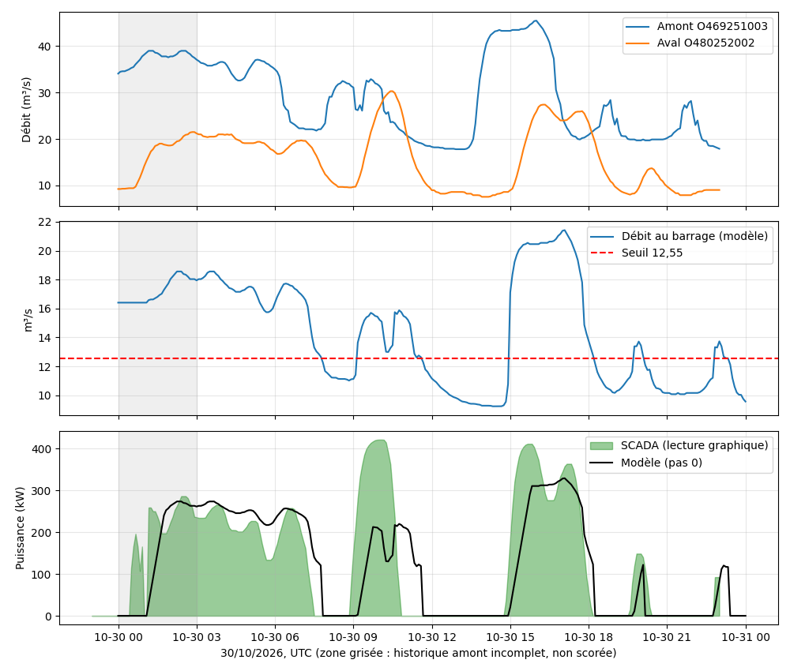

# Validation du modèle de turbine — journée du 30/10/2026

> Complète la section 8 de [`modele-turbine.md`](modele-turbine.md) (validation du 29/10).
> Tous les horaires sont en **UTC** sauf mention contraire. Phase de test bêta : ces résultats
> sont obtenus avec le jeu de paramètres précédent ; le recalage est décrit dans [`validation-2026-10-31.md`](validation-2026-10-31.md).

**Méthode.** Mêmes outils qu'au §8.1 de `modele-turbine.md` : le code réel (`turbineForecast`) est rejoué toutes les 5 min sur les CSV du 30/10 (stations amont et aval), et la puissance au pas 0 est comparée à la courbe SCADA de 24 h, lue graphiquement (±10 min, ±20 kW). Les 3 premières heures UTC ne sont pas évaluées : le modèle n'a pas l'historique amont antérieur à 00h. L'horloge SCADA est en avance de 2h08 sur UTC (démarrage réel à 23h55 heure de Paris, affiché 1h03 ; paramètres inchangés, valeur de 2h10 utilisée pour la lecture).

**Résultats avec les paramètres du §7 de `modele-turbine.md` (03h–23h UTC).**

| Indicateur | 29/10 | 30/10 |
|---|---|---|
| RMSE de puissance | 36 kW | **96 kW** |
| Énergie simulée / mesurée | 1621 / 1565 kWh (+4 %) | 2402 / 2645 kWh (−9 %) |
| Marche/arrêt correct | 89 % | 89 % |

Détail par plage (RMSE en kW) : plateau 03h–07h30 : 52 ; **événement du matin 07h30–12h : 167** ; après-midi 12h–19h : 78 ; soirée 19h–23h : 36. Hors événement du matin, le RMSE est de 60 kW.

**Constats.**

1. **Événement du matin non expliqué par l'amont.** La puissance mesurée atteint ~420 kW (≈ 28 m³/s au barrage) alors que le modèle estime ~15 m³/s. Le débit aval monte de 9,5 à 30 m³/s en 2 h puis retombe, sans pluie dans la journée. Le niveau de Vielmur (O460251001, 0,76–0,83 m) est plat, ainsi que celui de Graulhet (O477402001, 1–4 cm sur le 29 et le 30/10) : ni l'Agout au-dessus de Lavaur ni le Dadou ne portent de crue. La variation est d'origine non pluviale (manœuvre, lâcher ou travaux). Le gain amont → barrage n'est pas constant : ≈ 0,9 le matin, ≈ 0,6 l'après-midi.
2. **Gain et rendement se compensent.** Le calage du 29/10 ne reposait que sur la puissance : un rendement trop élevé était masqué par un gain trop bas. Avec le débit aval comme référence indépendante, on obtient sur trois plages de la journée `aval(t) ≈ 0,68·amont(t − 95 min) − 4,7` (RMSE 0,3 à 1,0 m³/s ; 4,1 sur la plage du matin). La puissance mesurée est 10 à 35 % sous la courbe de `modele-turbine.md` §5 entre 15 et 26 m³/s (rendement apparent ≈ 0,5–0,55 au lieu de 0,65). En utilisant le débit aval, décalé de ~35 min, comme débit au barrage, la courbe de puissance seule donne déjà un RMSE de 48 kW.
3. **Rampe trop lente.** Les montées observées atteignent 10 à 15 kW/min sur une forte hausse de débit (descentes ≈ 4 à 8 kW/min), contre 6 kW/min dans le modèle.
4. **Démarrage à bas débit.** Un démarrage a lieu à 22h55 UTC avec ~100 kW alors que le débit au barrage estimé est sous 12,55 m³/s (voir `modele-turbine.md` §9, point 1). Les petits cycles du soir (≈ 160 kW) sont correctement prévus, avec un pic de l'ordre de 120 kW.
5. **Le calage glissant dégrade le résultat** : avec `calibrationWeight` = 0,5 puis 1 et gain libre, le RMSE passe de 96 à 106 puis 122 kW (historique limité à 24 h dans ce test, au lieu des 72 h prévues).

**Suite.** Les relevés SCADA du 31/10 ont permis de recaler la courbe de rendement, la chute, le seuil d'arrêt et la rampe (voir [`validation-2026-10-31.md`](validation-2026-10-31.md)). Le jeu proposé ici (rendements × 0,8, gain 0,65) n'a pas été retenu : les mesures directes donnent un rendement plus **élevé** que l'ancienne courbe au-dessus de 45 % de charge, et non plus bas.

## Points ouverts mis à jour

- **Horloge du SCADA** : constatée à UTC+2h08 le 30/10 (démarrage de 23h55 heure de Paris affiché 1h03), alors que `modele-turbine.md` §8.1 supposait UTC+2. Le décalage peut dériver : à re-vérifier à chaque journée de validation.
- **Gain amont → barrage et rendement** : le calage ne repose que sur la puissance, donc les deux sont corrélés. Le gain varie aussi selon les événements (apports ou manœuvres non vus par la station amont).

## Suites (état avant le 31/10)

1. Retrouver les données du 29/10 (CSV H et Q des stations O469251003 et O480252002, capture SCADA 24 h) et tester un même jeu de paramètres sur les deux journées.
2. Relevés à charge intermédiaire (~60 %) pour fixer la courbe de rendement : heure, puissance, chute nette, vitesse, niveau amont.
3. Débit de Vielmur (O460251001) et information sur d'éventuelles manœuvres en amont de Lavaur, pour expliquer l'événement du matin.
