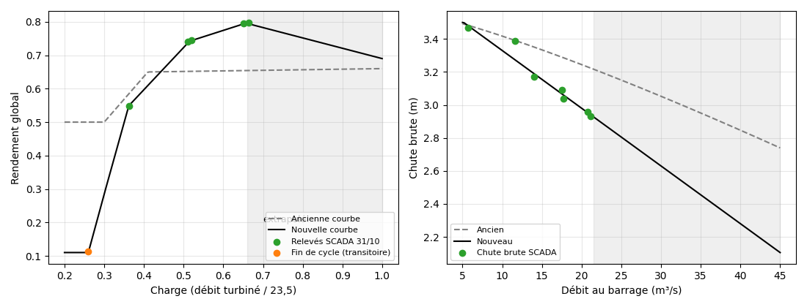
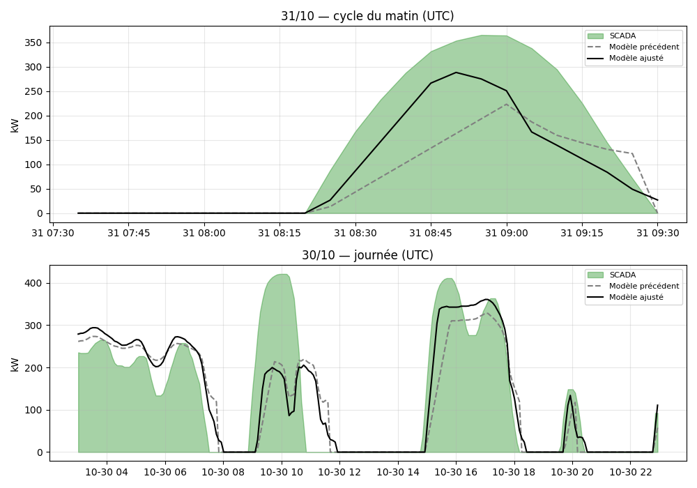

# Relevés SCADA du 31/10/2026 et recalage du modèle de turbine

> Complète [`modele-turbine.md`](modele-turbine.md) et [`validation-2026-10-30.md`](validation-2026-10-30.md).
> Heures en **UTC** sauf mention contraire. Phase de test bêta.

## 1. Données

- **7 lots** relevés pendant le cycle de production du matin du 31/10 (un lot toutes les ~10 min, 3 captures par lot : courbe de puissance sur 10 min, accueil avec le débit turbiné, synoptique avec les chutes), plus la courbe de puissance du cycle complet (2 h).
- **Horloge SCADA** : +1h08m11s sur l'heure de Paris dans les 21 captures, soit **UTC+2h08m11s** (Paris à UTC+1 depuis le 25/10).
- **CSV** : débits et niveaux des stations amont (O469251003) et aval (O480252002) du 31/10 ; niveaux de Vielmur (O460251001, 30/10) et Graulhet (O477402001, 29 et 30/10).
- Le « débit turbiné » du SCADA est cohérent avec la station aval : débit turbiné + 5,5 m³/s (réserve) retombe sur le débit aval décalé de 14 à 36 min selon la phase (voir §3).

## 2. Relevés (valeurs moyennes par lot)

| Lot | Heure Paris | Phase | Puissance (kW) | Chute brute (m) | Débit turbiné (m³/s) | Charge | Rendement global |
|---|---|---|---|---|---|---|---|
| 1 | 09:38 | montée | 269 | 3,09 | 12,0 | 0,511 | 0,740 |
| 2 | 09:50 | montée | 353 | 2,96 | 15,3 | 0,651 | 0,795 |
| 3 | 10:01 | palier | 358 | 2,93 | 15,6 | 0,664 | 0,798 |
| 4 | 10:11 | descente | 271 | 3,04 | 12,2 | 0,519 | 0,745 |
| 5 | 10:19 | descente | 145 | 3,17 | 8,5 | 0,362 | 0,549 |
| 6 | 10:29 | fin de cycle | 23 → 9 | 3,39 | 6,1 | 0,260 | 0,11 (transitoire) |
| 7 | 10:31 | arrêt (« Attente ») | 1 | 3,47 | 0,2 | — | — |

Rendement global = P / (9,81 · Q · H brute). Les relevés du lot 6 sont pris pendant l'arrêt de la turbine (débit affiché non représentatif d'un régime établi).

## 3. Constats

1. **Le rendement croît avec la charge** : 0,55 à 36 %, 0,74–0,75 à 51–52 %, 0,80 à 65–66 %. La courbe précédente (0,65 / 0,66 au-delà de 41 %) sous-estimait la puissance de 15 à 25 % entre 45 et 70 % de charge, et restait correcte à 36 % (−5 %). Les lots 1 et 4 (montée et descente) donnent le même rendement.
2. **La chute brute baisse plus vite que dans le modèle** : 3,47 m à 5,7 m³/s, 3,17 à 14, 3,07 à 17,6, 2,95 à 21. Le niveau aval remonte d'environ 3,4 cm par m³/s au-dessus de 6 m³/s ; l'ancien tarage (0,27 m de remontée à 21 m³/s au lieu de 0,5 m mesuré) surestimait la chute de 0,3 m.
3. **Seuil d'arrêt** : la production s'éteint à ~6 m³/s turbinés (débit au barrage ≈ 11,6 m³/s), soit 26 % de la capacité, plus bas que le seuil de démarrage (30 %).
4. **Rampe** : montées de 10 à 15 kW/min (jusqu'à 12 kW/min sur la courbe de 2 h), descentes de 8 à 12 kW/min.
5. **Délai barrage → station aval** : il dépend de la phase et du débit : ≈ 15 min vers 21 m³/s, 21–23 min en montée vers 17–21 m³/s, 29–32 min en descente vers 14–17 m³/s, ~36 min vers 11,6 m³/s.
6. **Vitesse de rotation** : 37 tr/min à 12 m³/s, 39 à 15,5 m³/s, 33 à 8,5 m³/s, 26 à 6 m³/s : elle ne varie plus guère au-dessus de 12 m³/s, donc elle ne sert pas d'indicateur de débit.
7. **Régulation** : consigne de niveau amont à −1,0 cm, puissance maximale de consigne 500 kW. La turbine suit le niveau.
8. **Événement du 30/10 matin** : ni le Dadou (Graulhet, niveau plat de 1 à 4 cm) ni l'Agout en amont de Lavaur (Vielmur, niveau entre 0,76 et 0,83 m) n'ont de crue. L'apport reste non expliqué (manœuvre ou lâcher ?).
9. **Gain amont → aval** : sur les deux jours, `aval(t) ≈ 0,68 · amont(t − 90 à 105 min) − 4,4` (RMSE 3,4 m³/s le 30/10, 1,7 le 31/10).

## 4. Paramètres modifiés dans `constants.ts`

| Paramètre | Avant | Après | Origine |
|---|---|---|---|
| `efficiencyCurve` | [0,3 ; 0,5], [0,41 ; 0,65], [1 ; 0,66] | [0,26 ; 0,11], [0,3 ; 0,285], [0,362 ; 0,549], [0,515 ; 0,742], [0,657 ; 0,796], [1 ; 0,69] | lots 1 à 6 ; 0,69 extrapolé des pics du 30/10 |
| `tailRating` | a = 0,0083, b = 1,2035 | a = 0,035, b = 1 | chutes brutes des lots (RMSE 0,03 m) |
| `tailRefLevel` | 0,05 m | 0,18 m | idem |
| `stopRatio` | 0,30 | 0,26 | lot 6 |
| `rampKwPerMin` | 6 | 12 | lots 1, 2, 4, 5 et courbe de 2 h |

Non modifiés : `defaultGain` / `defaultOffset` (0,44 / +1,4), `startRatio`, `stopHoldMin`, `calibrationWeight`.

Le choix d'un tarage linéaire (b = 1) plutôt qu'une loi de puissance (b = 1,43) donne le même ajustement sur la plage mesurée (RMSE 0,03 m) mais une extrapolation moins sévère : débit d'arrêt en crue ≈ 62 m³/s (contre 48 m³/s avec b = 1,43 et ≈ 97 m³/s avant).

## 5. Résultats rejoués avec le code réel

Le modèle est rejoué toutes les 5 min avec les seules données disponibles à l'instant considéré, et comparé à la courbe SCADA numérisée (écart de lecture ≈ 5 kW sur les 31/10, ±20 kW le 30/10).

| Jour (fenêtre UTC) | Indicateur | Avant | Après |
|---|---|---|---|
| 30/10 (03h–23h) | RMSE puissance | 95,0 kW | **82,9 kW** |
| 30/10, hors événement du matin | RMSE puissance | 60,1 kW | **42,0 kW** |
| 30/10 | Énergie simulée / mesurée | 2401 / 2638 kWh | 2561 / 2638 kWh |
| 30/10 | Marche/arrêt correct | 89,2 % | 87,9 % |
| 31/10 (07h35–09h35, cycle du matin) | RMSE puissance | 103,3 kW | **72,3 kW** |
| 31/10 | Énergie simulée / mesurée | 141 / 272 kWh | 177 / 272 kWh |
| 31/10 | Marche/arrêt correct | 95,8 % | 95,8 % |

La rampe apporte l'essentiel de l'amélioration (à elle seule : 84 kW le 30/10 et 68 kW le 31/10) ; la courbe de rendement, la chute et le seuil d'arrêt se compensent en partie sur la puissance mais rapprochent l'énergie du 30/10 de la mesure, et reproduisent les lots à 1 % près (test unitaire à 3 %).

## 6. Limites

- **Journée du 29/10 non rejouée** : ses CSV et captures ne sont plus disponibles ; le recalage n'a été validé que sur les 30 et 31/10 (le 31/10 n'est pas indépendant pour le rendement et la chute, qui viennent de ses relevés).
- **Extrapolations** : rendement au-dessus de 66 % de charge (0,69 à pleine charge) et chute au-dessus de 21 m³/s ; il manque des relevés SCADA au-dessus de 22 m³/s turbinés (lot à ≥ 25 m³/s au barrage).
- **Gain amont → barrage inchangé** : l'énergie du 31/10 reste sous-estimée de 35 % et le pic du matin n'est atteint qu'à 290 kW sur 363 mesurés. Appliquer `aval ≈ 0,68·amont − 4,4` améliore le 31/10 (RMSE 56 kW) mais fait surestimer l'énergie du 30/10 de 16 % : cette divergence entre les deux jours reste à comprendre.
- **Démarrage** : le modèle donne ~64 kW au seuil de démarrage alors que les démarrages réels affichent ~100 kW en transitoire.
- **Marche/arrêt du 30/10** : 87,9 % contre 89,2 % avant ; le recalage ne règle pas les démarrages à bas débit.
- **Figures 1, 2 et 6** de `modele-turbine.md` : tracées avec le jeu précédent, non régénérées.
- Les réglages déjà enregistrés dans le navigateur d'un utilisateur ne sont pas modifiés par ce changement de valeurs par défaut (à vérifier lors du déploiement bêta).

## 7. Suites

1. Retrouver les données du 29/10 et rejouer le même jeu de paramètres sur les trois journées.
2. Relevés SCADA à fort débit (≥ 25 m³/s au barrage) pour fixer le rendement et la chute au-dessus de 21 m³/s.
3. Comprendre l'écart de gain amont → barrage entre le 30/10 (événement du matin) et le 31/10.
